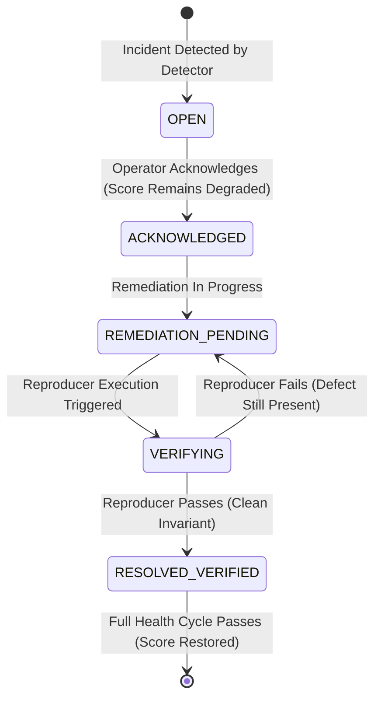

# OHMS ACTIVE HEALTH TEST ENGINE V2 — CONSTITUTION & PLATFORM SPECIFICATION
# BULLETPROOF ZERO-FAKE-GREEN • SELF-VERIFYING • EVOLVABLE DETECTOR PLATFORM

## Document Overview
This document formalizes the non-negotiable architectural constitution and runtime invariants governing the Onnesha Hospital Management System (OHMS ERP) Active Health Test Engine v2. Under no circumstances may application code, tests, CI pipelines, UI presentation layers, or AI assistants relax these rules for cosmetic, presentation, or reporting convenience.

---

## 1. Core Invariant Constitution (Rules H-001 through H-012)

### `RULE H-001 / HEALTH-001: Absolute 100% Health Standard`
A health score of exactly **100** and status **`HEALTHY`** may be emitted **ONLY IF**:
1. `required_check_count > 0`
2. `required_executed_count == required_check_count`
3. `required_pass_count == required_check_count`
4. `required_fail_count == 0`
5. `required_unknown_count == 0`
6. `required_skipped_count == 0`
7. `required_blocked_count == 0`
8. `monitor_error_count == 0`
9. `unresolved_incident_count == 0` (Zero open, acknowledged, or pending critical/warning incidents)
10. `latest_authoritative_check_is_fresh == TRUE` (within `p_max_age_seconds`)

$$\text{Any condition violated} \implies \text{health\_score} < 100 \quad \text{and} \quad \text{status} \neq \text{HEALTHY}$$

---

### `RULE H-002 / HEALTH-002: Non-Pass Semantics Law`
The following operational states MUST NEVER be evaluated, mapped, coerced, or interpreted as `PASS` or `HEALTHY`:
```text
UNKNOWN            != PASS
SKIPPED            != PASS
NOT_RUN            != PASS
UNAUTHORIZED       != PASS
AUDIT_UNAUTHORIZED != PASS
CONFIGURATION_ERROR!= PASS
MONITOR_ERROR      != PASS
EXCEPTION          != PASS
STALE              != PASS
BLOCKED            != PASS
BLOCKED_EXTERNAL   != PASS
PARTIAL            != PASS
```
Any check returning any of these states strictly reduces the score below 100 and marks status as degraded/unverified.

---

### `RULE H-003 / HEALTH-003: Authoritative Database Calculation (No Caller Overrides)`
Neither Antigravity, browser client, GitHub workflow, administrator UI, nor arbitrary API caller may declare or override:
```text
health_score = 100
status = HEALTHY
active_issues = 0
```
- Health scores and statuses MUST be derived exclusively by the authoritative database engine (`public.run_authoritative_health_cycle(p_org_id, p_source_sha)`).
- The caller supplies organization UUID context ONLY. Guessing via `LIMIT 1` is strictly forbidden.
- Telemetry supplied by unverified callers is strictly quarantined as untrusted.

---

### `RULE H-004 / HEALTH-004: Public Edge vs ERP Internal Domain Separation`
- **`PUBLIC_EDGE_WATCHDOG`**: Measures HTTP 200 edge availability, SSL termination, and fail-closed public PostgREST API security. Its success verdict is strictly **`PUBLIC_EDGE_HEALTHY`**.
- **`PRIVILEGED_ERP_MONITOR`**: Measures deep PostgreSQL database invariants across all 11 core hospital domains (General Ledger, Bed Occupancy, Referral Commissions, Invoice Non-Negative Invariants, Expense Linkages, Doctor Registry, Notification Outbox).
- Under NO circumstance may a `PUBLIC_EDGE_HEALTHY` result be reported as or imply `FULL_INTERNAL_ERP_HEALTHY` or full-system 100% compliance.
- When privileged credentials (`SUPABASE_SECRET_KEY`) are absent, the internal ERP domain MUST be explicitly classified as `AUDIT_UNAUTHORIZED` (Score 0) or `BLOCKED_EXTERNAL_OWNER (Gate G10)`.

---

### `RULE H-005 / HEALTH-005: Snapshot Freshness & Expiration (Stale Guard)`
A healthy verdict is ephemeral and must expire if continuous monitoring is interrupted:
- Authoritative health snapshots are valid for a maximum freshness window (`p_max_age_seconds`, default 900 seconds / 15 minutes).
- Once snapshot age exceeds this threshold:
$$\text{is\_stale} = \text{true} \implies \text{status} = \text{STALE}, \quad \text{score} = 0$$
- A healthy result from a previous run or yesterday never guarantees health today.

---

### `RULE H-006 / HEALTH-006: Open Incident Gate & Warning Ceiling Invariant`
1. **Zero Open Incidents Required:**
   Before returning 100, the database engine audits `public.system_health_issues_log`. If any incident has:
   $$\text{is\_resolved} = \text{false} \quad \text{and} \quad \text{lifecycle\_status} \in (\text{'OPEN'}, \text{'ACKNOWLEDGED'}, \text{'REMEDIATION_PENDING'}, \text{'VERIFYING'})$$
   the health score CANNOT be 100.
2. **Warning Score Ceiling:**
   $$\text{warning\_count} > 0 \implies \text{health\_score} \le 99, \quad \text{status} = \text{DEGRADED}$$
   Even a single active warning prevents 100% `HEALTHY`.
3. **Critical Score Ceiling:**
   $$\text{critical\_count} > 0 \implies \text{health\_score} \le 70, \quad \text{status} = \text{CRITICAL}$$

---

### `RULE H-007 / HEALTH-007: Manual Action Invariant (Verification-First Recovery)`
No user interface button (e.g., "Resolve", "Mark OK", "Dismiss") may directly reset the system health score to 100:
- An administrative action transitions an incident to `ACKNOWLEDGED`.
- Acknowledgement preserves `is_resolved = false` and keeps the health score degraded.
- An incident transitions to `RESOLVED_VERIFIED` ONLY after:
  1. The underlying source code or data anomaly is remediated in the database.
  2. The exact reproducer is re-executed and passes.
  3. The affected domain detector re-runs and returns `PASS`.
  4. The complete authoritative system health audit cycle passes.

---

### `RULE H-008 / HEALTH-008: AI & Report Citation Mandate`
Antigravity and automated reports MUST NOT independently fabricate system health status. All final closure reports must quote the exact verdict from the authoritative engine:
```text
Authoritative Engine Verdict: <database value>
Authoritative Engine Score:   <database value>/100
Authoritative Snapshot ID:   <snapshot UUID>
Evidence Hash:               <md5 hash chain>
```
If the database engine returns `NOT_FULLY_VERIFIED`, reports must faithfully print `NOT_FULLY_VERIFIED`.

---

### `RULE H-009: Versioned Detector Registry Invariant`
Every diagnostic check in the system MUST be registered in `public.system_health_detector_registry`.
- Each detector possesses a canonical detector key, category, domain, version, severity weight, execution timeout, and required flag.
- Modifications to detector configurations are audited immutably in `public.system_health_detector_registry_audit`.
- Built-in required detectors CANNOT be disabled without an auditable migration and admin authorization.

---

### `RULE H-010: Append-Only Run Ledger & Immutability`
All diagnostic executions are recorded in `public.system_health_detector_runs` as append-only telemetry.
- UPDATE and DELETE are strictly disabled via database triggers.
- Every run records runtime duration, status, raw metrics, and exact error payloads.

---

### `RULE H-011: Cryptographic Hash Chain on Snapshots`
Every authoritative snapshot created by `public.run_authoritative_health_cycle` produces a deterministic MD5 hash:
$$\text{Hash} = \text{MD5}(\text{prev\_hash} \,||\, \text{org\_id} \,||\, \text{score} \,||\, \text{status} \,||\, \text{timestamp} \,||\, \text{detector\_counts})$$
Snapshots form an immutable cryptographic chain, preventing retrospective tampering or retroactive score inflation.

---

### `RULE H-012: Zero Client-Side Override Law (Anti-Bypass)`
Client-side UI code, server actions, and middleware MUST NOT use optimistic fallbacks that mask database errors:
- Forbidden: `rawScore ?? 100`
- Forbidden: `status || 'HEALTHY'`
- Forbidden: `isAnonymousSecurityShield ? 100 : score`
- Allowed: Raw database truth rendered faithfully with fail-closed security shielding.

---

## 2. Invariant Score Ceiling Matrix

| Active Condition | Maximum Allowed Score | Permitted Status |
| :--- | :---: | :--- |
| **All Required Checks Pass + 0 Incidents + Fresh** | **100** | `HEALTHY` |
| **1 or more WARNINGS detected** | **99** | `DEGRADED` |
| **1 or more CRITICAL defects detected** | **70** | `CRITICAL` / `DEFECT_DETECTED` |
| **Required Check SKIPPED / NOT_RUN** | **90** | `NOT_FULLY_VERIFIED` |
| **Required Check UNKNOWN** | **90** | `UNKNOWN` |
| **Snapshot Expired (> 15 mins)** | **0** | `STALE` |
| **Health Engine Threw Exception** | **0** | `MONITOR_ERROR` |
| **Unprivileged / Anonymous Caller** | **0** | `AUDIT_UNAUTHORIZED` |
| **Public Edge Reachable, ERP Unverified** | **N/A (Watchdog)** | `PUBLIC_EDGE_HEALTHY (ERP: NOT_VERIFIED)` |

---

## 3. Registered Built-in Detectors (17 Detectors across 11 Domains)

| Detector Key | Domain | Severity | Required | Invariant Verified |
| :--- | :--- | :--- | :---: | :--- |
| `GL_DOUBLE_ENTRY` | Accounting | CRITICAL | Yes | Sum of debits == Sum of credits in General Ledger |
| `TRIAL_BALANCE` | Accounting | CRITICAL | Yes | Trial balance debits equal credits across accounts |
| `BED_OCCUPANCY_SYNC` | IPD | CRITICAL | Yes | Bed assignment active state matches bed occupancy status |
| `BED_WARD_FK` | IPD | CRITICAL | Yes | Bed to Ward foreign key integrity and ward capacity |
| `PATIENT_INTAKE_FK` | Patient | CRITICAL | Yes | Patient registrations maintain admission foreign-keys |
| `INVOICE_ARITHMETIC` | Billing | CRITICAL | Yes | Invoice balances non-negative and subtotal + tax = total |
| `REFERRAL_BOUNDS` | Referral | CRITICAL | Yes | Referral commissions cannot exceed billed amounts |
| `EXPENSE_LINKAGE` | Expense | CRITICAL | Yes | Hospital expense vouchers link to valid journal entries |
| `DOCTOR_DIRECTORY` | Platform | WARNING | Yes | At least one active OPD doctor configured |
| `NOTIFICATION_OUTBOX` | Notification | WARNING | Yes | No stale or errored SMS/email in notification outbox |
| `INCIDENT_LOG_ZERO` | Monitoring | CRITICAL | Yes | Zero unresolved incidents in system_health_issues_log |
| `RLS_SECURITY_POLICIES`| Security | CRITICAL | Yes | Critical patient and financial tables have RLS enabled |
| `DATABASE_BACKUP_FRESH`| Backup | WARNING | No | PITR / database backup executed within SLA (Gate G11) |
| `SERVICE_ROLE_AUTH` | Security | CRITICAL | Yes | Authenticated service_role or admin session required |
| `PAYMENT_GATEWAY_INTEG`| Billing | WARNING | No | Live payment gateway webhook secret configured (Gate G1) |
| `SMS_GATEWAY_INTEG` | Notification | WARNING | No | Bulk SMS provider API token configured (Gate G2) |
| `PACS_DICOM_INTEG` | Diagnostics | WARNING | No | DICOM PACS modality connection active (Gate G8) |

---

## 4. Incident Lifecycle State Machine & Audit

All health state transitions and incident status changes are immutably logged in `public.system_health_state_transitions`.



---

## 5. Non-Overridable Database Check Constraints

In `public.system_authoritative_health_snapshots`:
```sql
CONSTRAINT chk_no_score_100_without_healthy CHECK (NOT (score = 100 AND status != 'HEALTHY')),
CONSTRAINT chk_no_healthy_with_failed_checks CHECK (NOT (status = 'HEALTHY' AND failed_checks > 0)),
CONSTRAINT chk_no_healthy_with_unknown_checks CHECK (NOT (status = 'HEALTHY' AND unknown_checks > 0)),
CONSTRAINT chk_no_healthy_with_critical_issues CHECK (NOT (status = 'HEALTHY' AND critical_issues > 0)),
CONSTRAINT chk_no_healthy_with_open_issues CHECK (NOT (status = 'HEALTHY' AND open_issues > 0)),
CONSTRAINT chk_no_healthy_with_missing_checks CHECK (NOT (status = 'HEALTHY' AND passed_checks < required_checks))
```
These constraints make it physically impossible for PostgreSQL to store a score of 100 or status `HEALTHY` if any failed, unknown, skipped check, or active incident exists.
